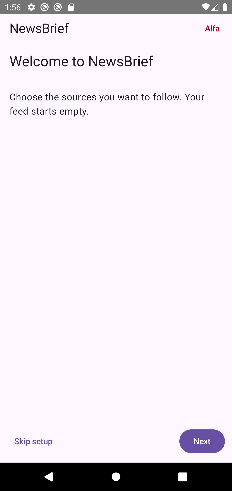
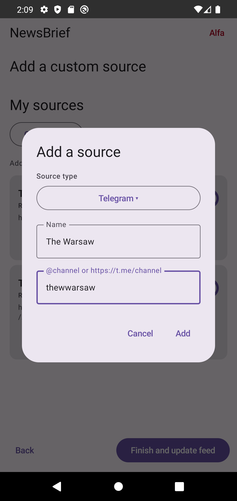
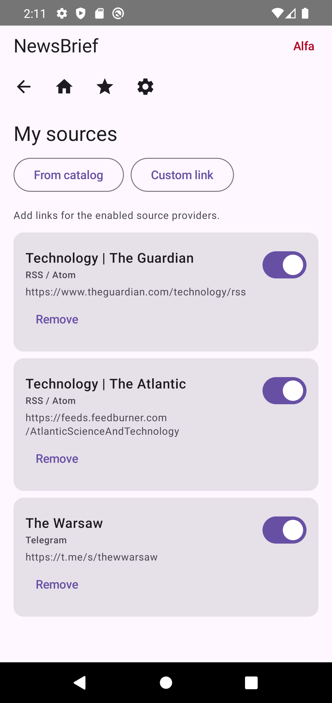
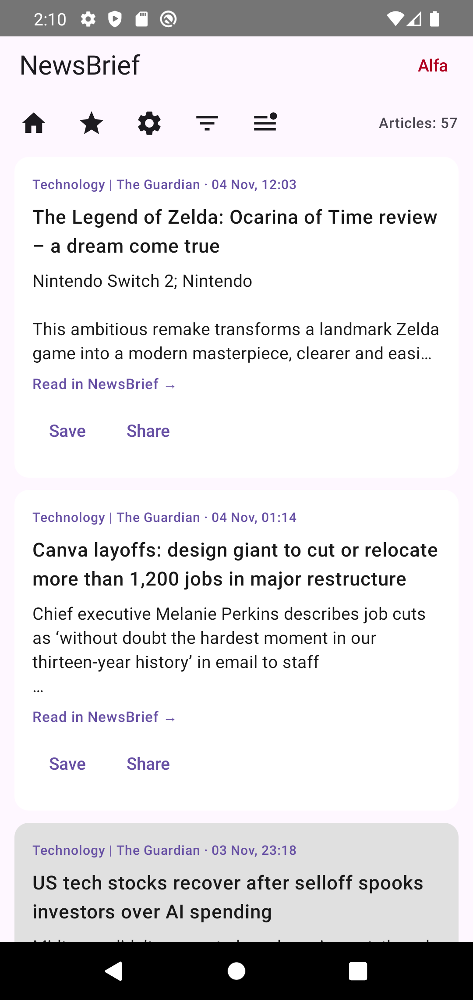
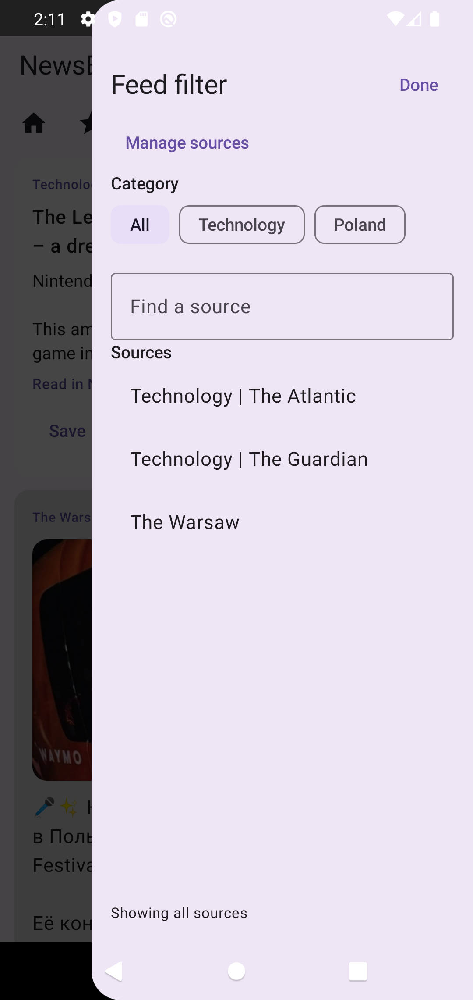
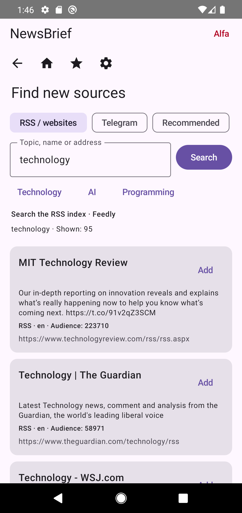
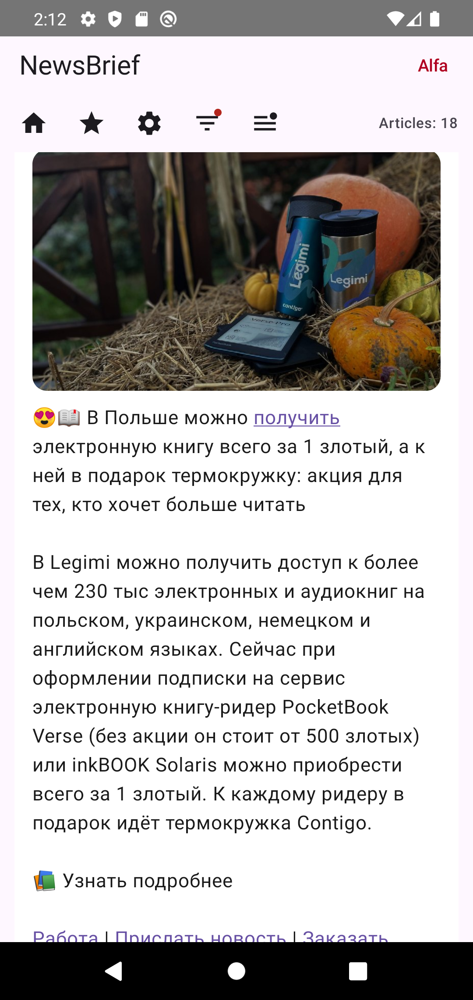
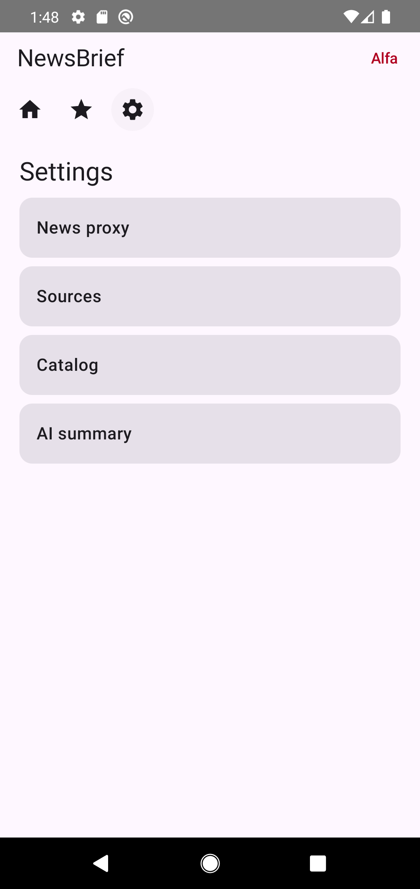

# NewsBrief — an AI-assisted News reader

NewsBrief is an open-source Android news reader that brings RSS/Atom feeds and public Telegram channels into one feed. It is an alpha project: source availability, article extraction, and the interface may change.

## Screenshots

Captured from release `v0.0.56-release-alfa` on an Android 10 emulator. News content changes over time.

| Welcome and setup | Choose a Telegram source | Configured sources |
| --- | --- | --- |
|  |  |  |

| News feed | Source filter | Source catalog |
| --- | --- | --- |
|  |  |  |

| Telegram post | Native reader | Module settings |
| --- | --- | --- |
|  |  |  |

## Using the app

### Set up sources

A new installation starts with no subscribed sources. The setup wizard welcomes the user, offers the source catalog when that feature is enabled, and provides a form for adding a custom RSS/Atom feed or public Telegram channel. Finishing setup refreshes the feed. Existing installations retain their sources.

The catalog can be searched for sources; its initial selection emphasizes technology. Users choose which sources to add and can manage them later. Public Telegram channels are read through their web previews; a Telegram account is not required for this mode.

### Read and organize

- The feed combines selected sources and displays article cards and Telegram posts. Pull down to refresh.
- The source filter narrows the feed to selected sources; an unread filter and saved-article view help organize reading.
- Posts become read after sufficient on-screen visibility. Swiping a card changes its read/unread state.
- Open an article in the native reader for extracted text and images, or open its original page in the embedded browser. Save and share actions are available.
- English and Russian interface translations are included.

The readable view depends on the publisher’s page and may not recover every article or remove every advertisement.

## Architecture

NewsBrief is built in Kotlin with Jetpack Compose. It stores articles, sources, read state, and related metadata locally with Room/SQLite. WorkManager schedules background updates, and OkHttp handles network requests.

The app uses feature modules with shared interfaces in `core/api` and runtime infrastructure in `core/runtime`. The assembly in `assembly.features` explicitly selects capabilities, including source discovery, RSS and Telegram providers, feed filters, storage, synchronization, the native reader, browser, and proxy support. Feature descriptors declare prerequisites; optional modules can be selected through the `newsbriefFeatures` Gradle property. See [BRANCHES.md](BRANCHES.md) for the module map.

Article loading supports feed content and extraction from publisher pages, including AMP when available. A Cloudflare Worker provides fetching, extraction, and image proxy endpoints. Sources that require proxying are routed through it; other sources may be requested directly. The Android application does not require a traditional application backend.

Synchronization stores per-source checkpoints where the provider supports paging. Stored articles can be read offline, but a source cannot recover posts it no longer exposes. Public Telegram previews and publisher pages can change or limit access. See [SOURCE-DISCOVERY.md](SOURCE-DISCOVERY.md) and [ARTICLE-PREFETCH.md](ARTICLE-PREFETCH.md) for implementation details.

## Related projects

- [NewsBrief Cloudflare article proxy](https://github.com/misterIncognito/newsbrief-proxy): fetches and extracts article content. **Private repository.**
- [NewsBrief Telegram service](https://github.com/misterIncognito/newsbrief-telegram): experimental account-based collector. **Private repository**; the integration is disabled in the current Android assembly.

Access to these repositories requires the owner's permission.

## Build and test

Requirements: Android Studio, JDK 21, and Android SDK 36. The app supports Android 8.0 (API 26) and newer. The repository includes the Gradle Wrapper.

```sh
./gradlew :app:testDebugUnitTest :app:assembleDebug verifyModuleInterfaces
```

The debug APK is written to `app/build/outputs/apk/debug/`. GitHub Actions runs the tests, interface checks, and debug build; successful integration and release branch builds publish alpha APKs on the [Releases page](https://github.com/misterIncognito/newsbrief-android/releases).

## Roadmap

- Complete AI summaries of the day’s news; experimental AI module code exists, but the feature is not yet finished.
- Add an app icon badge for new articles and a notification system.
- Adapt the app for iPhone.
- Explore Facebook groups as a news source, subject to available access and permissions.
- Complete testing of the disabled server-side Telegram account integration, intended to read streams using each user’s permissions.

## Limitations

The app is an alpha and its behavior may change. Source uptime, paging, full article extraction, and image availability depend on external services. Offline access covers content already downloaded to the device; it cannot retrieve new content without a connection.
