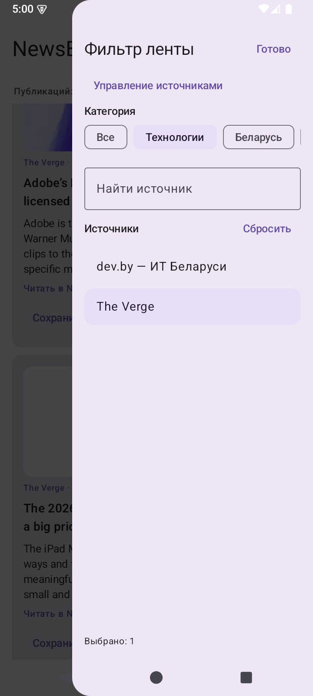

# NewsBrief — an AI-assisted News reader

**Type:** Personal Android application<br>
**Status:** Alpha, under active development<br>
**Repository:** [github.com/misterIncognito/newsbrief-android](https://github.com/misterIncognito/newsbrief-android)

## The idea

I follow news in several languages and use different channels to do it: mostly Telegram for Russian-language news, and RSS feeds for English- and Polish-language sources. Switching between apps and websites makes it harder to track what I have already read and get an overview of the day.

I wanted one place to follow my chosen sources, read articles in a cleaner format with fewer advertisements and distractions, and eventually generate an AI summary of the day’s news.

## What the application does

- Combines public Telegram channels and RSS/Atom feeds in one news feed.
- Lets users choose sources from a catalog or add their own. New installations start without preset subscriptions.
- Shows Telegram posts in the feed and opens linked articles in a readable view designed to reduce advertisements and distractions.
- Offers an embedded browser for opening the original page.
- Provides familiar reader features: read and unread tracking, source filters, saved articles, and sharing.
- Keeps downloaded articles and related information on the device for offline access.
- Uses a Cloudflare Worker to extract article content and access sources that require a proxy.
- Supports English and Russian interface localization.

## Screenshots

These emulator captures show an earlier version of the interface; the current alpha may look different. News content changes over time.

| News feed | Source filter | Native reader |
| --- | --- | --- |
|  |  |  |

## Implementation

- **Android:** Kotlin and Jetpack Compose.
- **Local storage:** Room and SQLite.
- **Background synchronization:** WorkManager, with per-source checkpoints where supported.
- **Networking:** OkHttp and a Cloudflare Worker; no traditional application backend.
- **Architecture:** Feature modules connected through interfaces, including source providers, article loading, the reader, and synchronization.
- **Testing and delivery:** Automated tests and GitHub Actions builds, with alpha APKs published through GitHub Releases.

## Plans

- **AI summaries:** Generate a summary of the day’s news. This is not implemented yet.
- **News badge:** Show a count of new articles on the app icon.
- **Notifications:** Notify users about new content.
- **iPhone support:** Adapt NewsBrief for iOS.
- **Facebook groups:** Add groups as a news source, reflecting their importance as a news and community information channel in Poland.
- **Telegram account integration:** Move beyond parsing public Telegram pages to a server-side Telegram account engine that reads streams with each user’s permissions. The integration has been implemented but is disabled until it has been fully tested.

The project is still in alpha. Article extraction and Telegram availability depend on the source, so a clean reading view or complete history cannot be guaranteed for every publication.

## Build and test

Open the project in Android Studio and allow Gradle to synchronize. To run the unit tests and build a debug APK from the command line:

```sh
./gradlew testDebugUnitTest assembleDebug
```

Alpha APKs are available on the [Releases page](https://github.com/misterIncognito/newsbrief-android/releases).
